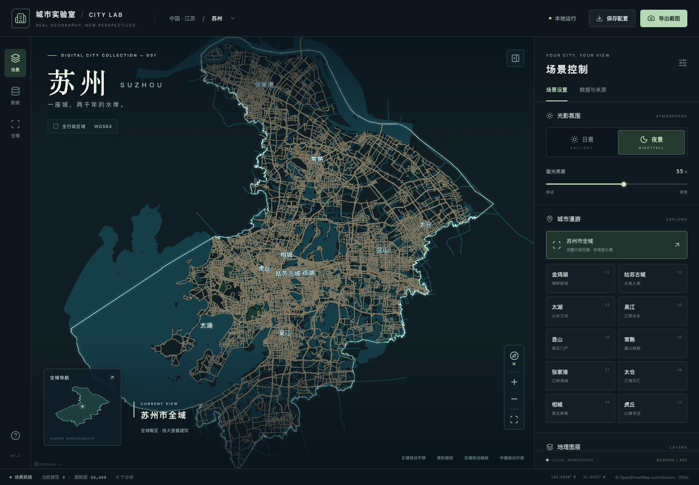
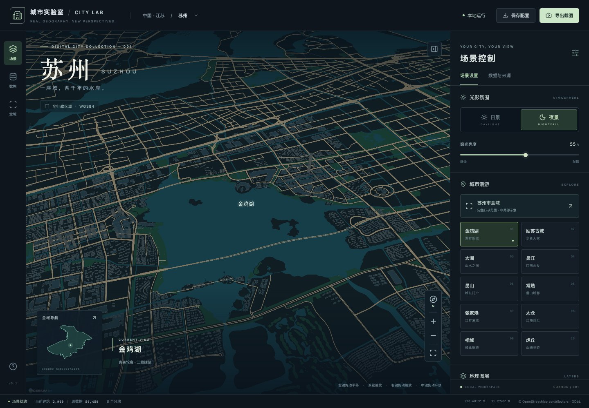

# City Lab · 苏州城市实验室

**真实地理数据驱动、可本地运行的三维城市生成与浏览工作台。**

City Lab 将 OpenStreetMap 中的道路、水系和建筑轮廓转为可交互的三维城市。
首个城市为**江苏省苏州市完整行政区域**，不是随机楼群，也不是仅覆盖金鸡湖的局部演示。
下载仓库、安装依赖并生成建筑瓦片后即可浏览，不需要地图 API Key、
Cesium ion 令牌或云端后端。

*A local-first 3D city workbench built with React, TypeScript and CesiumJS, using real OpenStreetMap geometry.*



> 项目实际运行画面。地理数据 © OpenStreetMap contributors，ODbL 1.0。
> 当前建筑采用真实轮廓拉伸，绝大多数高度为估算；本项目不是照片级实景模型。

[快速开始](#快速开始) · [功能与操作](#功能与操作) · [随库数据](#随库数据) · [数据更新](#数据准备与更新) · [开发](#开发验证) · [常见问题](#常见问题)

## 快速开始

### 环境要求

- Node.js **22.12 或更高版本**，以及随 Node.js 安装的 npm。
- 支持 **WebGL 2** 的桌面浏览器，并启用硬件加速。
- 首次安装依赖需要网络；随库提供基础地理数据，建筑瓦片可在本地离线生成。
- 当前全城建筑瓦片约 **5.2 GB**；生产构建会再复制一份到 `dist/`，请预留足够磁盘空间。

### 启动工作台

```bash
git clone https://github.com/hydavinci/city-lab.git
cd city-lab
npm ci
npm run data:architecture:build
npm run dev
```

打开 **http://127.0.0.1:5173**。项目附带 `public/data/` 下已生成的真实基础数据。
**首次启动必须执行 `data:architecture:build`**，将这些数据与随库生成器转换为
`public/architecture-city/` 下的建筑瓦片；该目录不加入 Git，也不需要 Git LFS。
全城生成耗时较长，命令会输出进度，中断后可重新执行以恢复已验证的批次。
基础数据或建筑生成器更新后需要再次执行；日常启动可以复用已生成资源。
`dev` 和 `build` 不会自动生成瓦片。

第一次体验无需执行 `data:fetch` 或 `data:build`，建筑生成不请求在线地图服务，
也不需要 Cesium ion 令牌、在线底图或外部字体。

### 生产构建

先完成上面的建筑瓦片生成步骤，再执行：

```bash
npm run build
npm run preview
```

打开 **http://127.0.0.1:4173**。生成的 `dist/` 包含页面、Cesium 运行资源和场景数据，
可部署到普通 HTTP 静态服务器的**根路径**。开发／预览服务默认只监听本机。

不要通过 `file://` 直接打开 HTML。当前尚不支持 `/city-lab/` 等 URL 子路径部署，
因此不能直接将现有构建配置用于 GitHub Pages 项目站点。

## 功能与操作

| 能力 | 说明 |
|---|---|
| 全市浏览 | 全域总览，以及金鸡湖、姑苏、吴江、昆山、常熟、张家港、太仓等定位点 |
| 三维建筑 | 真实轮廓拉伸；点选查看 OSM 标识、源记录、高度及估算依据 |
| 昼夜表现 | 日景／夜景、程序化窗光、亮度调节、泛光与高 DPI 抗锯齿 |
| 图层控制 | 建筑、水系、主要道路、绿地、行政边界、地名分别开关 |
| 按需加载 | 建筑分块加载与释放；显示当前建筑数、源数据总数和加载状态 |
| 配置与导出 | 本机保存配置、JSON 导入／导出、三维视图 PNG 导出 |
| 错误处理 | 数据失败提示与重试；“场景就绪”和截图等待实际几何准备完成 |



*实际运行的金鸡湖周边视图。窗光为可视化表达，建筑位置来自 OSM。© OpenStreetMap contributors。*

### 相机操作

| 操作 | 效果 |
|---|---|
| 左键拖动 | 平移 |
| 滚轮／右键拖动 | 缩放 |
| 中键／Ctrl+左键或右键拖动 | 围绕视图中心环绕 |
| 环绕时向上／向下拖动 | 靠近水平视角／回到俯视 |
| 单击建筑 | 查看建筑信息与数据来源 |
| “全域”或重置视角按钮 | 返回苏州市完整行政范围 |

鼠标环绕在每次拖动期间固定地面中心；视线落在天空时沿用最近的有效中心，不切换为原地转头。
接近水平时至少保留 **5° 俯角**，距离地面较近时进一步限制角度以保持离地距离。
松开鼠标、切出窗口或使用定位按钮后，都会释放拖动状态。

### 画质选择

| 档位 | 渲染像素密度上限 | 同时保留的建筑分块 |
|---|---|---|
| 流畅 | 1 倍 CSS 分辨率 | 4 |
| 均衡（默认） | 2 倍，适配高 DPI 屏幕 | 8 |
| 精细 | 3 倍，增加采样 | 14 |

均衡／精细启用 4 倍 MSAA，
不支持 MSAA 的环境使用 FXAA。窗口缩放或切换显示器后会重新计算分辨率预算。
窗光使用相机无关的局部坐标和像素覆盖滤波，远处无法分辨的窗户合并为平均亮度，
减少闪烁噪点。截图使用当前实际渲染分辨率。

远景自动隐藏建筑细节，靠近后按视口加载。**暂未显示不等于没有数据，也不等于现实中没有建筑。**

## 随库数据

仓库包含约 **45.3 MB** 的已处理基础地理数据，无需 Git LFS。
全城建筑 3D Tiles 是派生资源，不随 Git 提交；首次运行时按上面的步骤在本地生成。
下列统计来自 [`public/data/manifest.json`](public/data/manifest.json)，随数据更新可能变化。

| 项目 | 当前快照 |
|---|---|
| 范围 | 苏州市完整行政区域，OSM `relation/4430941` |
| 坐标 | WGS84，经度／纬度 |
| 建筑数据时间 | **2026-05-31 22:37:44 UTC** |
| 建筑轮廓 | **56,459** |
| 建筑分块 | **616** |
| 道路要素 | 46,090 |
| 水域／河流要素 | 10,054 |
| 绿地要素 | 1,882 |
| OSM 标注高度 | 177 栋 |
| 楼层推算高度 | 1,249 栋 |
| 类型默认高度 | 55,033 栋 |

“要素数”不是现实中的独立道路、河流或公园数量。全市采集范围也不等于现实建筑完整覆盖。
各图层采集时间可能不同，上述时间是建筑层对应的 OSM 数据库时间，不代表实时城市状态。

## 数据准备与更新

数据来源为 OpenStreetMap，苏州市边界为 `relation/4430941`。
下载器按边界、路网、水系、绿地、建筑分层请求，串行下载、有限重试。
公共 Overpass 服务可能繁忙或超时；已有完整缓存不会被失败响应覆盖。

```bash
# 获取尚未缓存或校验失败的源文件，再生成离线分块
npm run data:fetch
npm run data:build
npm run data:architecture:build

# 主动重新下载
npm run data:fetch -- --refresh
npm run data:build
npm run data:architecture:build

# 公共服务不可用时，使用你能访问的 Overpass 服务
OVERPASS_ENDPOINT=https://overpass-api.de/api/interpreter npm run data:fetch
npm run data:build
npm run data:architecture:build
```

`data:build` 对所有输入进行完整性检查，生成版本化数据目录，
最后才原子替换 `manifest.json`。失败不会发布成功形态的空数据。
原始下载缓存保存在 `data/raw/`，不加入 Git；处理后的基础数据保存在 `public/data/`。
建筑生成器读取基础数据，将全城瓦片和清单写入 `public/architecture-city/`；
代码、源资产和生成脚本随库提交，大型派生瓦片与其中的恢复记录仅保存在本地。
部署时必须包含生成后的建筑资源，不能只发布基础数据。
旧版本保留在 `public/data/`；磁盘空间不足时，可在停止服务后手动删除不再使用的版本目录，
不要删除当前清单指向的版本。更新后刷新浏览器；生产预览还需要重新运行 `npm run build`。

## 真实性与限制

- **全市采集范围不等于现实建筑完整覆盖。** 建筑、道路、水系的完整性取决于 OSM；
  缺失建筑不会由随机楼群补齐。道路层是主要路网，不包含所有支路。
- `height` 有效时使用 OSM 标注；否则按 `building:levels × 3.2 m` 推算，
  再缺失则使用确定性的建筑类型默认值。推算与默认高度都标记为估算。
- 建筑采用轮廓拉伸，没有逐栋立面、传统屋顶、地标精模、地下空间或室内。
  未处理 `building:part` 和 `min_height` 的复杂建筑结构。
- 地理底座为椭球，没有真实地形高程。窗光与泛光是可视化效果，不是真实照明记录。
- 使用 0.025° 网格索引 GeoJSON，不是 3D Tiles 服务。
  建筑按距离、视角和质量档位选取有限分块。水域／绿地／主要道路的概览层常驻内存。
- 首次加载和 GPU 资源占用与设备相关；没有对未经测量的设备承诺 30 FPS。
- 定位点仅用于相机导航，不是测绘控制点。项目是可视化工具，不用于测绘或工程决策。

更多来源与处理规则见 [数据说明](docs/data.md)；
设计和实施分解见 [design.md](docs/design.md) 与 [implementation-plan.md](docs/implementation-plan.md)。

## 技术栈与工程结构

| 层 | 技术与职责 |
|---|---|
| 界面 | React + TypeScript，中文控制面板、配置与交互 |
| 三维 | CesiumJS，椭球底座、批量几何、相机、局部坐标窗光材质 |
| 数据管线 | Node.js + TypeScript + osmtogeojson，清洗、推断、分块与版本化发布 |
| 工程与验证 | Vite、Vitest、Playwright |

```text
web/
  core/           共享地理规则、类型、配置校验
  scene/          Cesium 场景、材质、分块加载
  App.tsx         中文控制工作台
pipeline/         下载、规范化、版本化离线数据生成
data/raw/         原始下载缓存（不加入 Git）
public/data/      可直接运行的 OSM 派生数据与清单
public/architecture-city/  本地生成的全城建筑瓦片（不加入 Git，部署时必需）
tests/unit/       地理、配置、生成管线测试
tests/e2e/        真实浏览器交互、离线和错误路径测试
tests/fixtures/   清晰度与相机操作的浏览器测试场景
docs/             设计、数据说明与运行截图
```

数据处理采用 TypeScript，复用前端地理类型与推断规则，避免重复维护 Python 实现。

```text
OSM / Overpass
      │ 分层下载、缓存与校验
      ▼
data/raw/
      │ 清洗、去重、高度依据、空间分块
      ▼
public/data/<版本>/ + manifest.json
      │ 本地 HTTP 服务、按视口加载
      ▼
React 工作台 + Cesium 三维场景
```

## 开发验证

```bash
npm test
npm run build
npx playwright install chromium
npm run test:e2e
```

单元测试覆盖高度解析、边界孔洞、分块、配置校验、去重和失败发布保护。
浏览器测试覆盖离线启动、图层与配置、截图、分块重试／释放、GPU 几何就绪、
高 DPI、窗光稳定性，以及水平附近的环绕与导航恢复。

端到端测试需要先完成 `npm run data:architecture:build`，不访问在线地图服务；
浏览器缺失时先执行上面的安装命令。
测试会启动本地开发服务，或复用已经运行的 `127.0.0.1:5173`。

## 常见问题

**页面没有城市，或提示数据文件缺失？**

确认已完整克隆 `public/data/`，并通过 `npm run dev` 启动，而不是直接打开 HTML。
如果缺少建筑清单或瓦片，执行 `npm run data:architecture:build`，完成后刷新页面。
如果主动删除过基础数据，先执行 `npm run data:fetch && npm run data:build`，
再生成建筑瓦片。使用生产预览时还需要重新执行 `npm run build`。

**全市视角看不到建筑？**

这是远景细节策略。点击一个区域定位点或继续放大后会加载建筑。
底部状态栏中的“源数据”与“当前建筑”分别表示整个快照和当前已就绪的可见分块。

**画面锯齿、噪点或运行不流畅？**

确认浏览器启用了硬件加速。清晰度优先使用均衡／精细；资源有限时选择流畅、
关闭部分图层。更新代码后刷新页面，避免旧的运行中材质仍驻留内存。

**环绕到接近水平时怎么办？**

保持中键拖动，向下拉回俯视；无需重新载入数据。环绕带有安全俯角限制，
不会把相机继续压入地面。也可点击全域按钮恢复总览。

**Overpass 请求超时？**

公共服务可能繁忙。已有数据仍然可用，稍后重新执行下载命令即可复用成功缓存，
或通过 `OVERPASS_ENDPOINT` 指定其他可访问服务。

**端口被占用？**

开发服务使用固定端口 5173，预览使用 4173。先确认占用服务是否就是本项目；
不要直接结束不明进程。需要修改端口时调整 `vite.config.ts`，
并同步调整 `playwright.config.ts` 中的测试地址。

**可以换成其他城市吗？**

当前数据查询、行政边界校验和定位点针对苏州实现，尚不是任意城市的一键导入工具。

## 数据署名与许可

地理数据：© OpenStreetMap contributors，依据
[Open Database License](https://www.openstreetmap.org/copyright) 提供。
分发 `public/data` 或截图时保留适当署名；PNG 输出仅包含三维画布，
发布时应在图注中补充 `© OpenStreetMap contributors`。
CesiumJS 及其他依赖保留各自许可；本项目不包含商业地图服务的瓦片。
项目代码目前未另行声明开源许可证，不将地图数据的 ODbL 许可混同为全部代码的许可。
